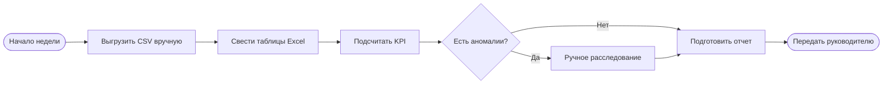
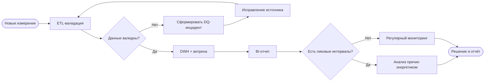

# Бизнес-процессы — AS-IS и TO-BE

Схемы отражают **предположительную** ситуацию, а не фактический процесс известного предприятия. Перед внедрением следует провести интервью и согласовать BPMN 2.0 с владельцем процесса.

## AS-IS (гипотеза)

## TO-BE (концепция)

**Важно:** Mermaid — удобная визуальная концепция потока; это не формальная BPMN 2.0 XML-модель. Для вакансии следует уметь устно описать события, задачи, шлюзы, роли и при необходимости перенести схему в BPMN-редактор.
