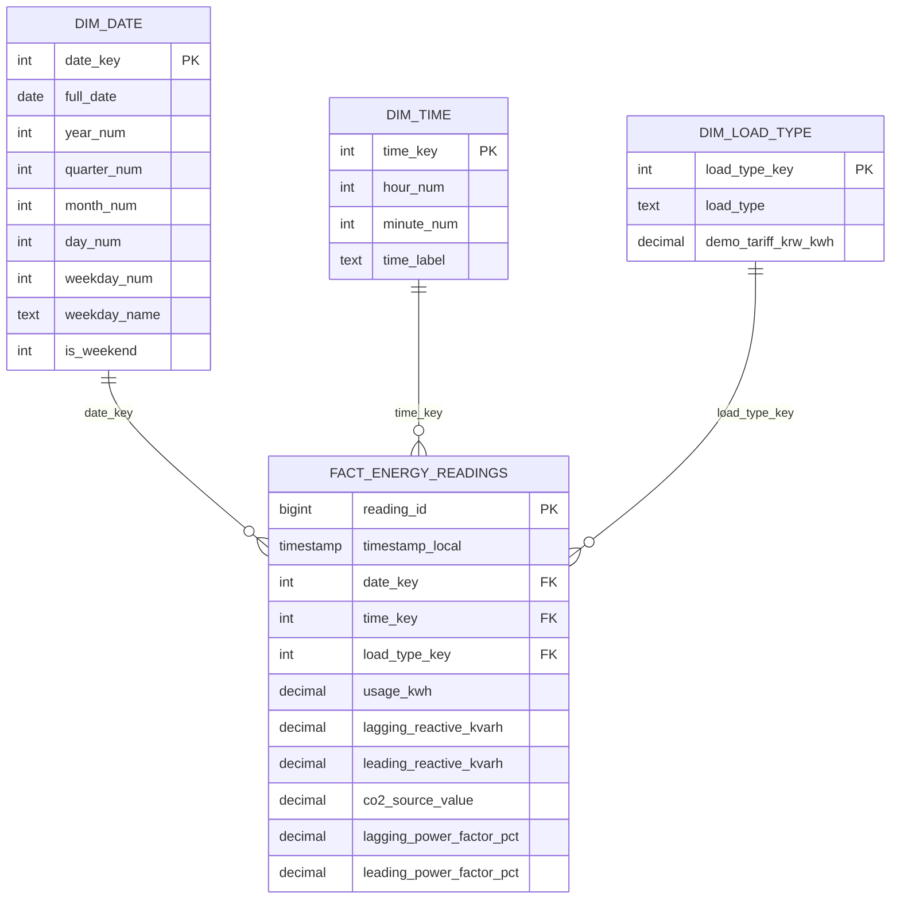

# Data Dictionary — схема данных и определения

## Источник

Источник реальных данных: UCI Steel Industry Energy Consumption, DOI 10.24432/C52G8C. Включённый в архив CSV — **синтетическая демоверсия с такими же именами полей**, 8 640 записей за 2025-01-01 — 2025-03-31.

| Поле CSV | Тип | Назначение |
|---|---|---|
| `date` | дата+время, локальное | Timestamp 15-минутного интервала |
| `Usage_kWh` | decimal | Энергия за интервал в кВт·ч |
| `Lagging_Current_Reactive.Power_kVarh` | decimal | Реактивная энергия, отстающий ток |
| `Leading_Current_Reactive_Power_kVarh` | decimal | Реактивная энергия, опережающий ток |
| `CO2(tCO2)` | decimal | Показатель из источника, **единица неоднозначна** в документации UCI |
| `Lagging_Current_Power_Factor` | decimal | Коэффициент мощности, % |
| `Leading_Current_Power_Factor` | decimal | Коэффициент мощности, % |
| `NSM` | integer | Секунды с начала суток |
| `WeekStatus` | text | Weekday / Weekend |
| `Day_of_week` | text | Monday ... Sunday |
| `Load_Type` | text | Light / Medium / Maximum Load |

## Модель «звезда»

## Ключи и меры

- `date_key` = целое YYYYMMDD; `time_key` = минут от начала суток (0, 15, 30, …, 1425).
- `load_type_key` = 1 (Light), 2 (Medium), 3 (Maximum).
- `reading_id` — технический детерминированный ключ после сортировки по времени.
- `timestamp_local` — уникальный бизнес-идентификатор строки в данном наборе; часовой пояс не указан и не домысливается.
- `usage_kwh` — аддитивная мера по непересекающимся интервалам.
- `estimated_cost_krw` — *производная мера витрины*, не колонка факта. Расчёт `usage_kwh * demo_tariff_krw_kwh`.
- Доля нагрузки — `SUM(usage_kwh)` по группе / `SUM(usage_kwh)` всего фильтра.
- `co2_source_value` — сохраняется без интерпретации единиц; не выводить в отчёт по экологическим KPI до уточнения методики.

## Доступные таблицы SQLite

`stg_energy_readings`, `dim_date`, `dim_time`, `dim_load_type`, `fact_energy_readings`, `project_metadata`, витрина `vw_energy_enriched`. CSV-экспорты пяти базовых таблиц находятся в `data/processed/`.
