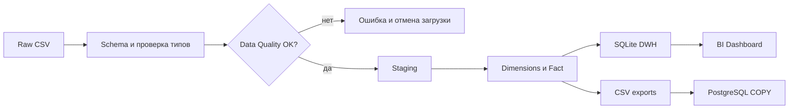

# ETL Specification

## Назначение

Загрузить 15-минутные измерения в локальную BI/DWH-модель; обеспечить повторяемость, неизменность исходника и контролируемое качество.

## Поток данных

## Маппинг и правила

| Источник | Приёмник | Трансформация |
|---|---|---|
| `date` | `timestamp_local` | Разбор даты, формат `YYYY-MM-DD HH:MM:SS` |
| `date` | `date_key` | `YYYYMMDD` |
| `date` | `time_key` | `hour*60+minute` |
| `Load_Type` | `load_type_key` | Нормализация подчёркиваний/пробелов + справочник |
| `Usage_kWh` | `usage_kwh` | numeric, >= 0 |
| `WeekStatus` | `is_weekend` в dim_date | Проверка соответствия календарю |
| `NSM` | staging | Должен совпасть с timestamp |
| `CO2(tCO2)` | `co2_source_value` | Только numeric; не интерпретировать единицы |

### Проверки

1. Наличие всех обязательных колонок и непустой набор.
2. Даты корректны, уникальны, попадают на 15-минутную сетку.
3. Все количественные поля числовые и неотрицательные; коэффициенты мощности от 0 до 100.
4. `Day_of_week`, `WeekStatus` и `NSM` согласованы с датой и временем.
5. `Load_Type` входит в известные категории.
6. После загрузки количество строк и сумма `usage_kwh` совпадают с source.
7. В режиме UCI файл имеет 35 040 строк; архивная демоверсия — 8 640.

### Идемпотентность и обработка ошибок

SQLite строится во временном файле `*.new.sqlite` и заменяется только после успешной обработки и проверки итогов. При ошибке преобразования прежняя база не изменяется. Экспорт CSV и SQLite рекомендуется запускать через единый ETL; для production потребуется полноценная транзакция/атомарная публикация набора файлов, журнал загрузок и управление версиями источника.

### Полнота временного ряда

Дубли timestamp проверяются; отсутствие отдельных 15-минутных точек **пока не считается критической ошибкой** (нужно согласовать реальный календарь измерений и downtime). Не заполнять пропущенные интервалы нулём без бизнес-правила.

### Обновление

Включённый прототип делает full refresh. Для реальной BI-платформы стоит проектировать инкрементальный ETL, watermark, partitioning и audit logging — это **не реализовано** в текущем коде.
